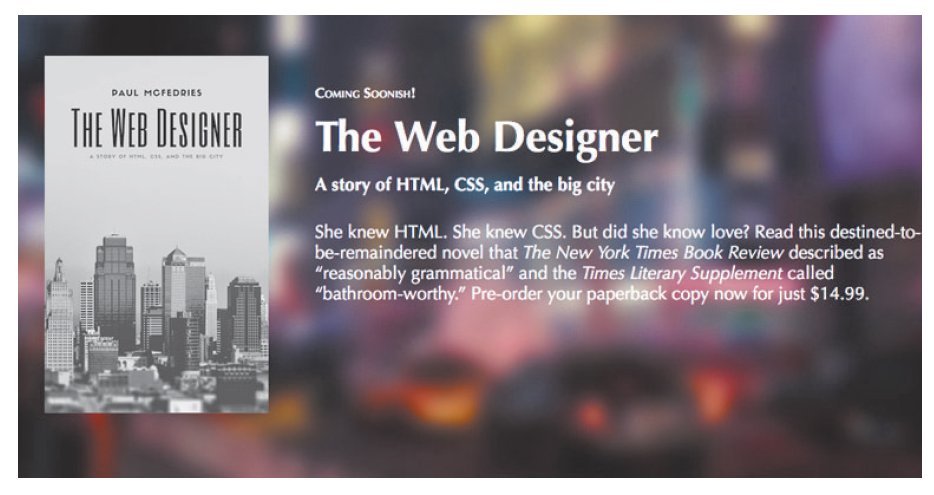
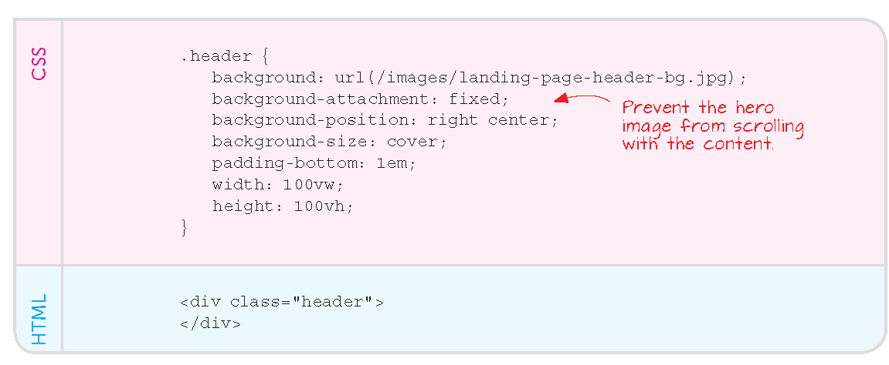
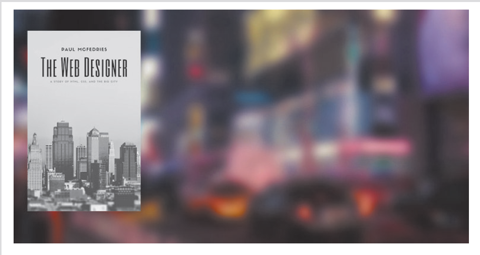
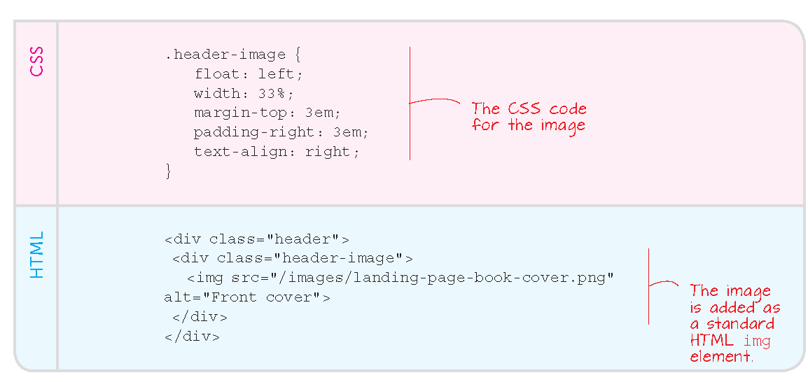
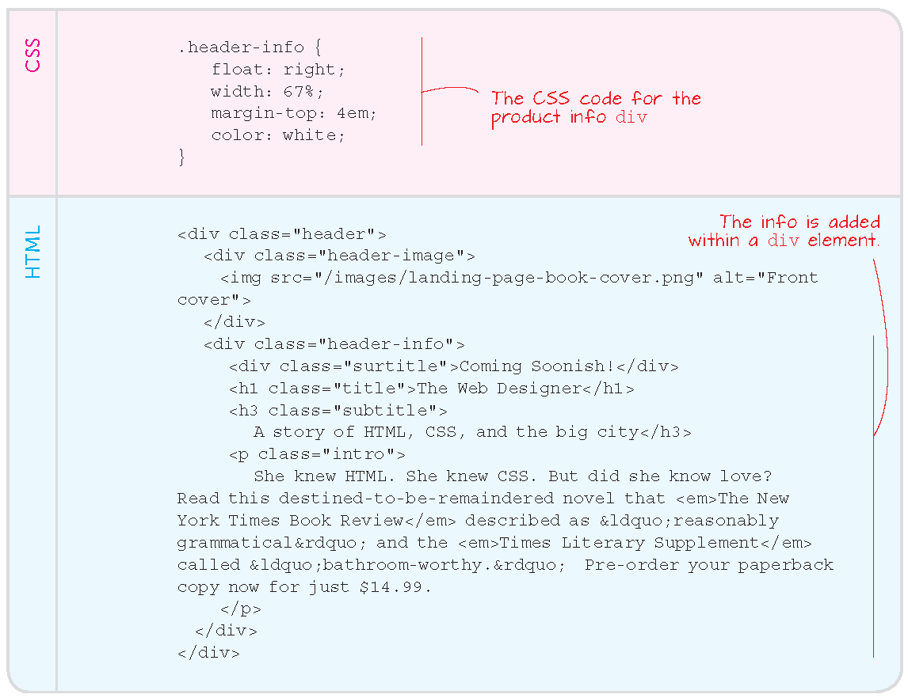

# The Limits of HTML

---

## Three theses against HTML

- a: the page orientation 

- b: the static layout
  
- c: the landing page


# A: The page orientation

---

## So far...


- each HTML page is a stand-alone, complete page

- even recurrent elements, e.g., links to reference pages, are repeated

- pages might share a common CSS file, but not the HTML structure itself


---

## Case study

- [unimi.it](https://www.unimi.it/en/education) offers more than 150 study programs

- each programme page has a similar structure and most information is actually replicated

- yet, in principe we should come up with 150+ HTML pages


---

## Idea: semantic tagging

recurrent parts of the page are annotated by *invisible,* semantic tags

although invisible, the tags guide presentation, and can be replicated across the whole platform, e.g., ``unimi.it``


# B Static layout

---

## So far

pages are intended as rectangular: relatively narrow and tall

- like the book page

- like the computer screen


---

## Solutions, a

The CSS may define *boxes* with padding around them

The boxes may *float* so the browser will assign it dynamically to the available *viewport*

. . .

However, browsers present elements one after the other, until space on the right ends and they continue on a new line below: __undesirable effects and even collapse__


---

## Experience: floating elements

- [Ex. 8.1: Floating elements](https://webdesignplayground.io/lessons/8-1-0)

Elements start [overflowing](http://wdpg.io/8-1-3) to the *line* below


---

Explict placing: not recommended

- [Ex. 8.2: Positioning elements](https://webdesignplayground.io/lessons/8-2-0)


---

## Experience: boxes with padding

Creating boxes of text: [Ex. 9.1](https://webdesignplayground.io/lessons/9-1-0)

Padding around them: [Ex. 9.2](https://webdesignplayground.io/lessons/9-2-0)


For reference: a better finish

- [Ex. 9.3](https://webdesignplayground.io/lessons/9-3-0): Applying a Simple Border

- [Ex. 9.4](https://webdesignplayground.io/lessons/9-4-0): Controlling the Margins


# Intermezzo: in-class project 

---

## Checkpoint

Have a version of the `30-visuals/exercise-a` folder with 

  - own hero page for COM 
  - own style in `mystyle.css` and/or `fonts-style.css`
  - owm images in `./imgs/`
  - links on the page, images embedded
  - YT and GM embeds, 
  - possibly, own video (upload to new folder `./videos/` or `./av/`)


---

## Today

- obtain GH account

- get own folder on `learn-web-playground-2026-27`

- copy materials there

- make floating menu with useful links

- box up some official text from `https://com.cdl.unimi.it/en` and make it float

- make a menu of navigation links and float it (details in past presentations) 

try *pair coding* with your neighbor via the [Live Share](https://marketplace.visualstudio.com/items?itemName=MS-vsliveshare.vsliveshare) VS Code extension


# C: Landing pages

---

Hero page: 

- seeks an emotional response

- graphics takes over from text

. . .

Landing page

- extends hero

- the page that search engines point

- seeks to entice and guide a deeper visit

---

## Example landing page


---

## Make a landing page

- Create a *hero image* that is fixed wrt. scrolling but also contains the claim

- go picture-in-picture, e.g.



---

Fixed *landing:*



---

Left picture is the *what*, background picture is the *where* or *how*



*lab* on *Velasca?* the other way around? Keep *lab* and choose an aspirational picture that works for you and your friends

---

## The in-picture




---

## The in-text




Check the final effect with the [Live server](https://marketplace.visualstudio.com/items?itemName=ritwickdey.LiveServer) VS Code extension

---

## Solutions, b

Complex CSS files can define three (computer, tablet and smartphone) or more *locales* 

sense the device and apply the appropriate styles

Example: section with links collapses into the *hamburger* menu


#  For reference: `before::` and `after::`

---

## ::after

We can avoid mis-rendering by forcing browsers to create the visual effects in a certain order

The ``::`` notation is for *pseudo-elements:* we don't see them in the HTML but they go into the *final* page.

The CSS is now changing the HTML!

---

## ::before

apply a certain style before the browser starts rendering the element

See the [example from w3schools](https://www.w3schools.com/cssref/tryit.asp?filename=trycss_sel_before)

```css
p::before { 
  content: "Read this -";
  background-color: yellow;
  color: red;
  font-weight: bold;
}
```

---

``::before,`` ``::after`` and ``::first-letter`` are advanced CSS language

we only cover them by example

See [reference](https://www.w3schools.com/cssref/css_selectors.php)

---

## Styling tables and other structured texts

See the relevant self-learning material at 

[w3chools](https://www.w3schools.com/bootstrap5/bootstrap_tables.php) and 

[bootstrap](https://getbootstrap.com/docs/5.0/content/tables/)


