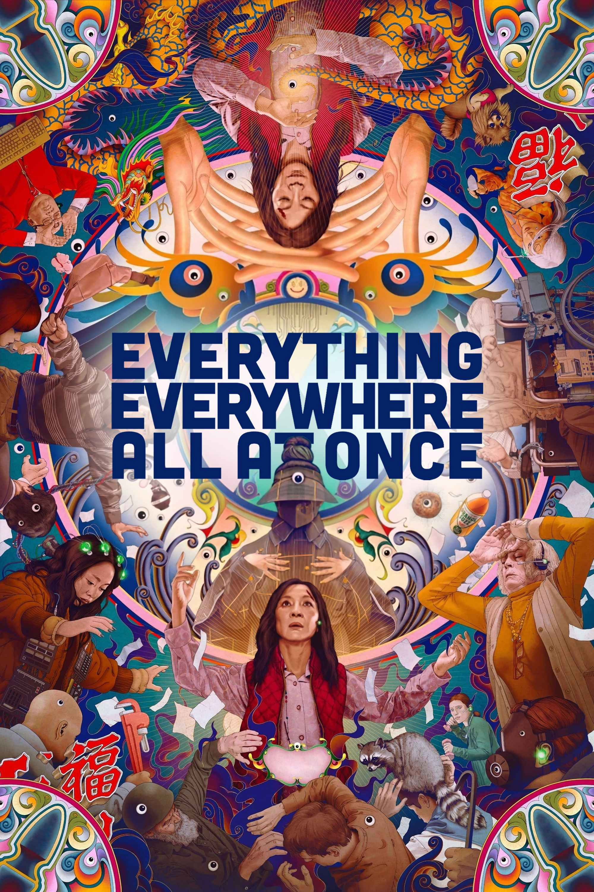

# Recap

---

## Concepts, a

CSS styles from anywhere can be integrated

So do AV resources: files to be linked or embedded

---

## Concepts, b

The DOM representation

```{mermaid}
%%| echo: false
flowchart LR
  A[html] --> B[head] & C[body]
  B --> D[title]
  C --> E[h1] & F[p] & G[p] & H[p]
  E-.-> I[.my-hero-title]
  D --> L[My DOM page]
  E --> M[My visible title]
  F --> N[some text]
  G --> O[more text]
  H --> P[further text]
```

for each leaf, a special `innerHTML` variable will contain the relative text and mark-up


# In-class project Recap

---

## Objectives

Work on a simple project to learn how to

- arrange files in your computer, work with the terminal (aka CLI: Command Line Interface)
  
- edit HTML+CSS files with VS Code: div, class .hero-style{}

- link up this and that, embed images, videos, podcasts
  
- use the Git collaboration software

. . .

- develop *your own web style* 


---

## Issues so far

- terminal must be 'pointed' to the *right* folder (check with `dir`/`ls -lrta`, use `cd` to reach there) 

. . .

- I have 
  - `learn-web-main.zip` (must *unzip* first, but see below)

  - `learn-web-main/` (install git and `git clone` a fresh copy)

  - 2 or more copies of `learn-web/` (may delete all but the *working copy*)

--- 

## More issues

- VS Code preview malfunctions (get `Live Preview` by Microsoft or `HTML Preview` by George Oliveira)

. . .

- low *scaffolding:* learn everything, everywhere, all at once (read slides to catch up)


[{width="20%"}](https://en.wikipedia.org/wiki/Everything_Everywhere_All_at_Once)


## In-class project, so far

---

### Refactor the MA COM landing page

[](https://com.cdl.unimi.it/en)

can you do a better job than that? 

---

## Milestone

By now you should have, typically in `30-visuals/exercise-a/`

- an `index.html` file you edited to add *divs,* text, links etc.

- a `mystyle.css`file with your styles (or `myfonts.css`)

- some extra images in `./imgs/`


# Publishing pages

---

## Going online

pages (.html files) that sit as a specific folders of an internet-connected computer, called *server* become *visible*

a server has
- fixed internet address (unlike phones/home wi-fi)
- software that manages traffic in/out our disk (`ngix`, `xampp`...)

. . .

Instead, experiment by uploading pages to the free GitHub project

---

## Go online by going GitHub

1. join GitHub with your `name.surname@studenti.unimi.it` email; get a `name.surname` id

2. send your id to instructor by PM on Teams

. . .

1. from a terminal, log into GitHub (details in `34-git/index.html`, page ...)

. . .

3. clone a copy of the class exercise: 

```bash
git clone 
```

---

4. look inside: there's a folder in your id name
  
5. copy into it your project: `index.html`, `mystyle.css` and the `imgs` folder

6. git commands to create a new version

```bash
git commit -a -m "Wow, this is my initial commit!"
```

7. push your version into GitHub

```bash
git push
```

8. check your project online at `https://ale66.github.io/in-class-project2627/name.surname/`

9. check it also on your smartphone


# Week 5

---

## Page animation: Javascript (JS)

JS *functions* can be attached to a page

At parse time, the browser attaches them to the HTML elements that they are defined to alter

At render time, they will alter the DOM and make visualisation *dynamic*


---

```html
 <button type="button" onclick="changeSeason('summer')">Verano</button>
```

A new tag for buttons

A *listener:* if we click then the *action* associated to `onclick` is executed

A Javascript function `changeSeason()` is called, with input value `'summer'` 

