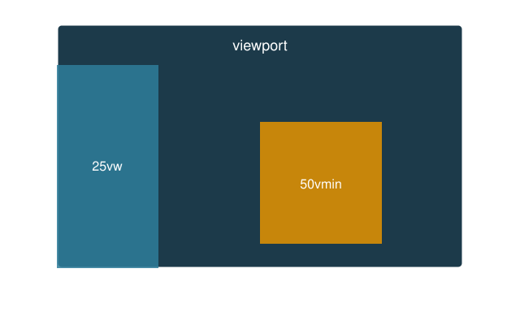

# CSS measures: recap and exercise


---

## Instructions

Work in pairs, preferably

Read the slides trough, look up things as you go through

Work on the exercise individually, on your own project

ask the instructor for questions or help with your project

ask your colleague to check your web site on their computer/phone

---

## Recap: the viewport

the part of the page that is visible in the browser window (or on the phone screen)

Its size changes with the device, and with the window on a desktop

. . .

Mobile browsers assume a virtual width of circa 980px and then shrink the page to fit: everything looks tiny

---

## Set the viewport right

Tell the browser to use the real screen width, add in the `<head>`:

```html
<meta name="viewport"
      content="width=device-width, initial-scale=1.0">
```

`width=device-width`: the page is as wide as the screen

`initial-scale=1.0`: no zoom when the page first loads

---

## So far

A page is *responsive* when it adapts to the device (viewport) it runs on.

Boxes and text must therefore be sized in a way that *adapts*, not in a way that stays fixed.

Available *units of measure:* 

`px` &rarr; `rem` &rarr; `em` &rarr; `%` &rarr; `vw`, `vh` and friends


# Absolute: px

---

## `px`

fix the physical device (a display or a printer, each have PPI *density)

Q: what is the PPI of your smartphone? Search for your phone specs

---

A *pixel* is a fixed measure: 96px to an inch, 28.3px to a cm.

```css
div {
  width: 200px;
  padding: 20px;
  border: 5px solid black;
}
```

Predictable, easy to reason about

**not adaptive/responsive**: neither to the screen, nor to the reader's preferred font size

---

## `px` is fixed

Things that should *not* scale:

- borders: `1px solid`

- thin shadows and outlines

- small fixed gaps

For text and layout, prefer relative units.


# Relative to the root: rem

---

## `rem`

`rem` = *root em*: relative to the font size of the `html` element, *for the whole page*

```css
html {
  font-size: 20px;
}
```

Now 1rem = 20px, 1.5rem = 30px and so on

. . .

By default, browsers set `font-size: 16px;` so 1rem = 16px

---

## Respect the reader

```css
html {
  font-size: 100%;   /* good: follows the browser setting */
}
```

```css
html {
  font-size: 16px;   /* bad: ignores it */
}
```

A reader who raised the default text size in the browser gets a page that grows with it, only if we use `rem`, not `px`.

---

## `rem` in practice

```css
h1 { font-size: 2rem;   }  /* 32px  */
p  { font-size: 1rem;   }  /* 16px  */
small { font-size: 0.8rem; }  /* 12.8px */

section {
  padding-top: 2rem;
  padding-bottom: 2rem;
}
```

Change `html { font-size }` once and everything scales together.


# Relative to the container: em


---

## `em`

`em` is relative to the font size of the *container* we're in, not the whole document

```css
.card {
  font-size: 20px;
}
.card p {
  font-size: 1.5em;   /* 30px */
}
```

---

## `em` compounds

```css
.a { font-size: 20px;  }
.b { font-size: 1.5em; }   /* inside .a */
.c { font-size: 1.5em; }   /* inside .b */
```

::::{.columns}

:::{.column width="50%"}
| element | size |
|---------|------|
| `.a` | 20px |
| `.b` | 30px |
| `.c` | 45px |
:::

:::{.column width="50%"}
Nested elements keep multiplying!

`rem` never does: it always goes back to the root.
:::
::::

---

## So when is `em` useful?

When a measure should *follow the element's own text size*

```css
.button {
  font-size: 1rem;
  padding: 0.5em 1em;   /* scales with the button's text */
}

.button.big {
  font-size: 1.5rem;    /* padding grows too, for free */
}
```

---

## `rem` or `em`?

| | `rem` | `em` |
|---|---|---|
| relative to | root `html` | parent / element itself |
| nesting | no surprises | compounds |
| use for | font sizes, page spacing | padding / margin inside a component |

. . .

Rule of thumb: `rem` by default, `em` inside components


# Setting the base


---

## Summary: set the font size first

Almost every other measure is *derived* from the font size

- `rem` is a multiple of the root font size

- `em` is a multiple of the element's font size

- `%` on `font-size` is a share of the parent's font size

. . .

So: decide the **base font size first**, then express everything else relative to it

```css
html {
  font-size: 100%;     /* 16px, or what the reader chose */
}
```

---

## Why first?

Change *one line* and the whole page scales: text, padding, margins, headers

Set later, or in `px` in many places, and you must hunt down every value

. . .

Set it on the wrong element and the units drift:

`rem` only looks at `html`, so a `font-size` on `body` or on `*` does *not* change what `1rem` means


---

## Summary: `*`, `html`, `body`

```css
* { box-sizing: border-box; }

html { font-size: 100%; }

body { font-family: sans-serif; line-height: 1.5; }
```

| selector | matches | typical use |
|----------|---------|-------------|
| `*` | *every* element, one by one | `box-sizing`, resets of `margin` and `padding` |
| `html` | the root element | base `font-size` (the reference for `rem`) |
| `body` | the visible page, child of `html` | `font-family`, `line-height`, `color`, background |

---

## `*` is not inheritance

A rule on `html` or `body` is *inherited* by the elements inside

A rule on `*` is applied to *each element directly*, and beats inheritance

. . .

Good for properties that are **not** inherited:

`box-sizing`, `margin`, `padding`, `border`

Bad for properties that **are** inherited:

```css
* { font-size: 1.2em; }   /* compounds on every nested element! */
```

Put `font-size`, `font-family`, `color` on `html` or `body` and let them flow down


# Percentages


---

## `%`

Relative to the *parent box*

```css
div {
  width: 50%; 
  padding: 20px; 
  border: 5px solid black;
}
```

will always take up half of the parent, whatever the screen

Remember `box-sizing: border-box;` so that padding and border stay *inside* that 50%

---

## Careful

`%` means *different things* for different properties

- `width`, `margin-left`, `padding-right`: % of the parent's *width*

- `height`: % of the parent's *height*, which must be set explicitly, or it does nothing

- `font-size`: % of the parent's font size


# Viewport units: vw, vh


---

## Measuring the viewport

Units that take the *viewport* as reference, as seen at the start



---

## `vw` and `vh`

`1vw` = 1% of the viewport *width*

`1vh` = 1% of the viewport *height*

```css
.hero {
  height: 100vh;    /* as tall as the window */
  width: 100%;
}

.sidebar {
  width: 25vw;      /* a quarter of the window */
}
```

---

## `vmin` and `vmax`

`1vmin` = 1% of the *smaller* of the two viewport dimensions

`1vmax` = 1% of the *larger* one

```css
.square {
  width: 50vmin;
  height: 50vmin;   /* a square that always fits on screen */
}
```

Turn the phone: the square keeps fitting.

# In-class project

---

## Exercise, a 

Follow instructions on Ch. 13 of [wdpg.io/lessons/13-4-0/](https://webdesignplayground.io/lessons/13-4-0/)

add a __media query__ to your CSS: make the page look different on mobile

- a disappearing side note (13-1-0 to 13-3-0)

- image resize (13-5-0)

- advanced: the `<nav>...</nav>` manu becomes an *hamburger*

git status/git add --all/git commit -m ""/git push

ask a friend to check on their smartphones

---

## Exercise, b 

start from your `mystyle.css`

- set `html { font-size: 100%; }`

- convert all font sizes from `px` to `rem`

- make the `header` height `5rem` instead of `64px`

What happens when you change the browser's default text size?

---

## Exercise, c

amend the *.hero* setup

- full window height with `min-height: 100dvh`

- a title with `clamp(1.5rem, 5vw, 3rem)`

- a button whose padding is in `em`

What happens when you 

- resize the window?

- turning your phone sideways?

next page shows a cheatsheet

---

| unit | relative to | typical use |
|------|-------------|-------------|
| `px` | nothing (fixed) | borders, shadows |
| `rem` | root font size | font sizes, vertical spacing |
| `em` | element / parent font size | padding inside components |
| `%` | parent box | widths, horizontal spacing |
| `vw` / `vh` | viewport width / height | full-screen sections, fluid text |
| `vmin` / `vmax` | smaller / larger viewport side | squares, backgrounds |

---

## Conclusions

`px` for what must *not* scale

`rem` for text and spacing, `em` inside components

`%` for what follows the parent

`vw`, `vh` for what follows the screen: cap them with `clamp()`

Add all these setups to your `mystyle.css` and bring it with you across projects
