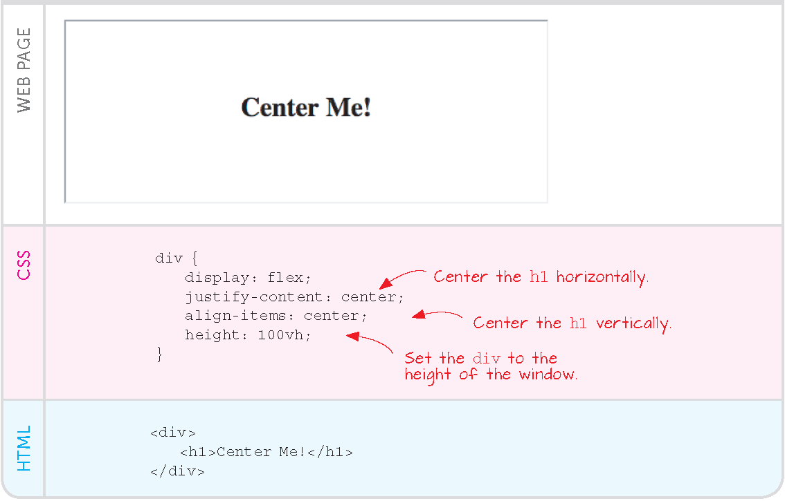
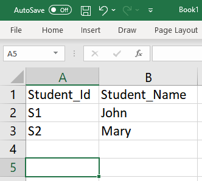

# Recap

---

## Concepts, a

The flexbox approach, ch. 12 of the textbook

- sees the page as a collection of *blocks* containing text, AV etc.

- CSS styles determine how the blocks are shown in the page

- essential ingredient: `display: flex`



---

## Essential ingredient: `display: flex`

{width="60%"}

---

## Concepts, b

Thw e WaterCSS online CSS

include it from a *CDN*


---

## Concepts, c

Javascript functions can change all aspects of the page at runtime

Two ways to embed JS into HTML:

- a: direct embedding

```html
<div>
  <script>
    console.log("I'm at the beginning of Ch. 4. Users won't see this message")
  </script>

  <h2>Chapter 4</h2>
  ...
</div>
```

---

- b: *listeners* capture user behaviour and launch JS functions to react

```html
<button type="button" onclick="changeSeason('summer')">Verano</button>
```

we define the JS function in a separated file, e.g., `./scripts/myfunctions.js`

Event `onclick` is one of an handful of event types that can be listened to, e.g. `dblclick`, `mouseover` ...

Listeners can be added dynamically:

```js
element.addEventListener('submit', function() {console.log('the form has been submitted')
                        });
```

---

## Concepts, d

Javascript allows iteration over collections of values, called lists

How we see it:

{width="40%"}

. . .

How the browser sees it:

```js
Student_ID = ["S1", "S2"]
```

---

Alternatively:

```js
Student_ID[0] = "S1"
Student_ID[1] = "S2"

Student_Name[0] = "John"
Student_Name[1] = "Mary"

i=0

console.log(Student_Name[i])
```

{width="30%"}


