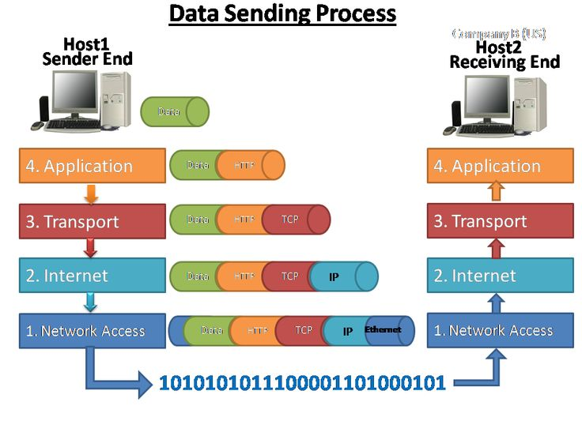
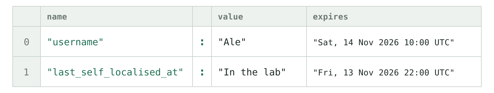

# Cookies


---

## The HTTP(S) protocol

HTML files become *web pages* when they become accessible online, not just locally

This is possible thanks to a *stack* of communication protocols: WiFi/TCP/IP/HTTP/HTTPS




---

## pages feel *local*

in fact, a copy of the HTML+CSS+JS files is saved in a *secret* local folder 
which is managed by the browser

HTTPS is designed to make browsers follow up links or download needed files *transparently*

- clicking on `<a>`s sends us to a new page, local or web

- online images, style files etc. are fetched and rendered

. . .

we realise that this is all networked *only when it stops working*


---

## HTTPS is *stateless*

each page request is dealt the same

there is no history of a visit to a site, only our browser may remember

Yet, 

. . .

- we feel *progress* through stages of the visit, e.g., in e-commerce

- pages are customised for country, language etc.

- they remember us returning

---

## Cookies

A small text file which is saved in a *secret* local folder which is managed by the browser

keep record of previous visits and help in *customising* pages

inside, there's a tiny database organised in attribute/value pairs: 

`"name"="ale"; "last_visit"="15-11-24"; "hour"=14; ...`

JS functions create/read/amend cookie files

In principle, it's public information, and local


---

Let's visualise cookies.

Please add [SQLite Manager (by Lunu)](https://add0n.com/sqlite-manager.html){target="_blank"} to your Browser!


---

## Instructions

@firefox: [https://addons.mozilla.org/en-US/firefox/addon/sqlite-manager-webext/](https://addons.mozilla.org/en-US/firefox/addon/sqlite-manager-webext/){target="_blank"}

try

```html
about:support
```

on your browser, or follow instruction on [http://mzl.la/1BAQULj](http://mzl.la/1BAQULj){target="_blank"}

Example: Firefox 132 on Win11:

`C:\Users\aless\AppData\Roaming\Mozilla\Firefox\Profiles\kqgptv3l.default-release\cookies.sqlite`

---

Open file *cookies.sqlite* with the browser extension

search for our cookie, e.g. with

```sql
select * 
from "moz_cookies" 
where name = "likejavascript"
```

---

## For other browsers

The same process can be done by opening the cookies file directly from the file systems, as described [here (for Win 10)](https://www.digitalcitizen.life/cookies-location-windows-10/){target="_blank"}.


Example: Crome on Win10:

`C:\Users\aless\AppData\Local\Google\Chrome\User Data\Default\Network`


---

### In-class work

Design user profiling for your MA COM refactoring page:

- ask one or more questions using buttons

- record choices/preferences in cookies.

- on second visit we shall salute them with their name and invited them to enroll!


# Case study


## Forms: we collect data

Users can assign values to variables thanks to [forms](https://www.w3schools.com/html/html_forms.asp){target="_blank"}.

Forms require attention as there are many [form attributes](https://www.w3schools.com/html/html_forms_attributes.asp){target="_blank"} and details.

Please complete the subsequent units *a la carte:* look at the forms you deem useful for your work on a COM landing page.


---

## Collect emails?

Today, browsers collect lots of user behaviors, e.g., scroll speed in Facebook-like pages. 

Independent web sites may create a user base or a *community* around a web presence

Idea: use forms to collect emails (not identities) to manage a simple circular email system, weekly or monthly.

GDPR regulation restricts *consent, safe storage* etc.

See the [Mailchimp](https://mailchimp.com/en-gb/){target="_blank"} software.


# Cookies lab


---

## the baseline

inside folder `boilerplate` see files `rename-me.html`, `mystyle.css` and `script.js`

open them all in VS Code, read the HTML and the CSS

Notice how `checkCookie()` is executed every time the browser (re)loads `<body>`

next, load the page on Firefox etc and open the console (CTRL+SHIFT+k) 

check the cookie then refresh to check second-time behaviour

---

## Inside the browser's memory



---

## Handle JS

Proper learning JS is beyond the scope of `github.com/ale66/learn-web`

Learn how to run pre-packaged JS functions

Let's learn

- set a cookie value in the browser memory, assign name, value and expiration date (days)

- read a cookie value from memory into a JS variable (then act on it)

- check whether there are cookies already, in particular, `username`


---

- set a cookie value in the browser memory, assign name, value and expiration date (days)

```js
function setCookie(cookie_name, cookie_value, cookie_validity_in_days) {
  /* sets the 'expires' value to the value of cookie_validity_in_days from now
    it is done in milliseconds
  */
```

In page:

. . .

```html
<script>
  setCookie("username", "Ale", 365)

  setCookie("self_localisation", "Via Passione", 0.5)
  ...
</script>
```

---

- read a cookie value from memory into a JS variable (then act on it)


```js
function getCookie(cname) {
  /* if the cookie named cname exists then return its value, 
    else return ""
  */
```

In page:

. . .

```html
<script>
  visitor = getCookie("username")

  if (visitor != "") {
    possible_email = visitor + "@studenti.unimi.it"
  }
  ...
</script>
```

---

- check whether there are cookies already, in particular, `username`


```js
function checkCookie() {
  /* if the 'username' cookie exists already  
      then salute the returning user
  */

  console.log("Now, the available cookies are:", document.cookie);
  ...
}
```

In page:

. . .

```html
  <!-- this JS function executes as soon as the browser reads line 17
      i.e., when the page is still not rendered, which happens at the end
      of reading the body (line 48)
  -->
  <body onload="checkCookie()">
    ...
```

---

## Lab

read the `script.js` file line by line, don't move on until you understood 

Look up on W3Schools parts that are new, e.g., `while`

place a `console.log()` or an `window.alert()` at each step to visualise the content of the variables, e.g.

```js
user = prompt("Thanks for visiting! Please enter your name:", "");

if (user != "" && user != null) {
```

. . .

becomes

```js
user = prompt("Thanks for visiting! Please enter your name:", "");
console.log('User has entered '+ user)
if (user != "" && user != null) {
```
