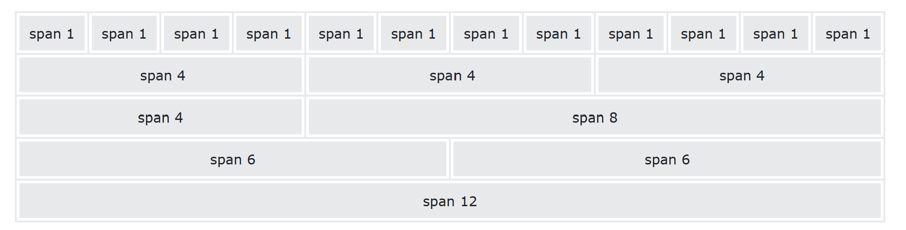

# Bootstrap 5


---

## Today, web pages

- must be responsive (to the display) but `flex` and `@media` are often complicated
  
- are tedious to write, with lots of HTML and CSS: errors ensue

- contain large HTML+CSS boilerplates that should be included automatically

- because of JS, all relevant items of the page have *classnames* and *ids*


---

## New ideas

A new, online CSS and JS 'for all'  

An intermediate *canvas* will support page design 

under the canvas, powerful JS functions take care of resizing etc.

big rectangles, called *containers,* support touch-based navigation

A myriad of small improvements that deploy *hidden* JS functions to traditional HTML components

On balance: bit more HTML ids but much less CSS+JS

---

## The canvas

The visible space is divided into (up to) 12 columns

some columns may be *lumped* together into wider cols.



automatic column re-arrangement in response to screen size


---

## Hands-on Bootstrap, a

Read carefully the [Bootstrap 5.3 template](https://www.w3schools.com/bootstrap5/trybs_template1.htm)

> responsiveness is sorted, mobile is first: think how to deploy BS5 containers to your MA COM project.

---

## Hands-on Bootstrap, b

- locate `82-bootstrap/rename-me/`, make a copy of the folder and rename it

- also rename `rename-me.html` to `index.html`

- open it and check the step-by-step copy-paste described on [getbootstrap.com/docs/5.3/getting-started/introduction/](https://getbootstrap.com/docs/5.3/getting-started/introduction/)

- copy your personal `mystyle.css` and paste it the just-renamed folder 

- link it from `index.html`: place the link *below* the BS5 link

---

## More Bootstrap

Test zooming on your smartphone:

```html
<meta name="viewport" content="width=device-width, initial-scale=1">
```

Also images are responsive:

```html

```

---

## The grid system

*The BS grid system is built with flexbox and allows up to 12 columns across the page*

*we may group some columns together to create wider columns*

*The grid system is responsive, and the columns will re-arrange automatically depending on the screen size.*

Up to 12 columns

4 breakpoints (xs, sm, md, lg)

[Grids](https://www.w3schools.com/bootstrap5/bootstrap_grid_basic.php)

[Containers](https://www.w3schools.com/bootstrap5/bootstrap_containers.php)

---

## Rows are nestable, containers are not

```html
<div class = "container">

   <div class = "row">
      <div class = "col-*-*"></div> 
      
      <!-- .col-xs-N .col-sm-N .col-md-N .col-lg-N -->

      <div class = "col-*-*"></div>
   </div>
   
   <div class = "row">...</div>
 
</div>
```

[Grid examples](https://www.w3schools.com/bootstrap5/bootstrap_grid_examples.php)

try ``<div class="col-sm-4">`` vs. ``<div class="col-xs-4">``.


# BS5 features


---

## Try out

* [Typography](https://www.w3schools.com/bootstrap5/bootstrap_typography.php)

* [Colors](https://www.w3schools.com/bootstrap5/bootstrap_colors.php)

* [Images](https://www.w3schools.com/bootstrap5/bootstrap_images.php)

---

## More hands-ons 

* [Forms](https://www.w3schools.com/bootstrap5/bootstrap_forms.php)

* [Dropdowns](https://www.w3schools.com/bootstrap5/bootstrap_dropdowns.php)

* [Progress bars](https://www.w3schools.com/bootstrap5/bootstrap_progressbars.php)

---

## Lectured

[Tables](https://www.w3schools.com/bootstrap5/bootstrap_tables.php)

[Button groups](https://www.w3schools.com/bootstrap5/bootstrap_button_groups.php)

[Pagination](https://www.w3schools.com/bootstrap5/bootstrap_pagination.php)


---

#### But how does it work?

With BS5 we are *leasing* a visual language from a third-party project

If 1000 users load our page at once, the 1000 copies of the BS5 CSS and Javascript need to be downloaded, apparently from a single source.

Web-scale delivery depends on a complex operation, described [here](https://www.jsdelivr.com/network/infographic).


# For reference: Canvas

---

## The Canvas (advanced)

JS functions can be used to draw on a canvas element

games, animations, data visualization

Skilled in computer art? Take the [MDN tutorial](https://developer.mozilla.org/en-US/docs/Web/API/Canvas_API/Tutorial/Basic_usage) 
