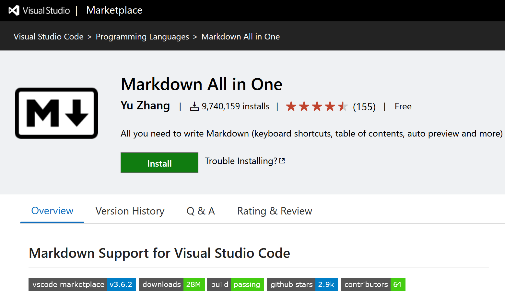

# Markdown/HTML injection


---

## Mark-up, a recap

Enrich the text with annotations that may describe 

- its structure: `<body>`, `<header>`, `<p>` ...

- how it should be rendered: `<h1>`, `<b>` ... 

- the meaning of its parts: `<title>`, `<quote>` `<article>` ...  

. . .

Residual cases:

- tags inside `<head>` for indexing etc., in particular `<meta>`

- tags inside `<body>`, e.g., `<div>` and `<span>`

---

## Currently

- we are editing HTML documents to provide a bit of all this
  
- the text is irremediably mixed with the mark-up

- the mark-up is not very readable and often repetitive

---

## The Markdown vision

1. prepare a text file with all the content but only minimal annotations: the Markdown file `my_contents.md`

2. feed it to a *parser* software, e.g., *Pandoc* that *renders* it: 

   - HTML tags are *injected* into the file, and 
  
   - CSS styles are linked and assigned to tags
  
3. the thus-created `my_page.html` can be manually refined/tweaked, if it so needs

4. publish it

---

## Markdown rendering

MD code is *rendered* into HTML equivalent annotations

platforms with web page generation support MD contents and render them automatically:

- MyAriel

- GitHub

---

## MD is useful:


in a MD-generated `my_page.html` file:

- fixed parts, e.g., `<body>...</body>` are automatically incorporated

- annotations are interpreted and incorporated:

    - `# My title` --> `<h1>My title</h1>`
  
    - `__N. B.__` --> `<b>N. B.</b>` and so on

- less error-prone than HTML

- extra fragments can be easily integrated (unlike with HTML)

- uniform page appearance

---

MD files are essentially parsed and rendered row by row

it is possible to put HTML tags into a MD file and to see them in the rendering.

```html
### this is an h3 title in MD


__this is a boldface caption to the image__
```

---

## MD interpreters

- install the MD extension for VS Code

- edit in-browser with 
  - [markdownreader.github.io/](https://markdownreader.github.io/){target="_blank"}
  - [tomarkdown.org/editor/](https://www.tomarkdown.org/editor){target="_blank"}
  - [markdownviewer.org/](https://markdownviewer.org/){target="_blank"}


# Learn MD

---

## Get started 

Study the simplified language on [GitHub](https://docs.github.com/en/get-started/writing-on-github/getting-started-with-writing-and-formatting-on-github/basic-writing-and-formatting-syntax) where interpretation is automated

GitHub interprets Markdown automatically

Example: [collapsed sections](https://docs.github.com/en/get-started/writing-on-github/working-with-advanced-formatting/organizing-information-with-collapsed-sections)

---

## Mardown in VS Code

VS code supplies a preview of the rendering of `.md` files

install the [Markdown-all-in-one](https://marketplace.visualstudio.com/items?itemName=yzhang.markdown-all-in-one) extension by Yu Zhang

The page explains how to code MD quickly




# The Pandoc software

---

## [Pandoc](https://pandoc.org/) = all documents.

Peels the decorations off, gives the content to the needed __injector__

On Win, install it via [Chocolatey](https://community.chocolatey.org/packages/pandoc):

```bash
choco install pandoc
```

On Apple, use [Homebrew](https://brew.sh/):

```bash
brew install pandoc
```

---

## Work with Pandoc

Magic commands to transform files:

```bash
pandoc --from=txt mytext.txt -t html -o mypage.html 
```

```bash
pandoc --standalone --from markdown --to html5 myfile.md -o mypage.hmtl
```

more examples [here](https://pandoc.org/demos.html).


# The limits of MD

---

There is no industrial standard:

ambiguity ensues

`` --> 

::::{.columns}
::: {.column width="50%"}
```html

```
:::
::: {.column width="50%"}
```html


<h6>My text</h6>
```
:::
::::

Use Pandoc/Quarto Markdown

---

## two meanings for `[]()`


`[linked text](https://www.unimi.it)` --> 

. . .

`<a href='https://www.unimi.it'>linked text</a>`

. . .

`` --> 

. . .

``


# Summary of the method 

---

- Markdown is the simplest, lightest form of text annotation

- Pandoc software takes our MD text and generates an equiv. HTML page

  - fragments for inclusion into an existing page, or 
  - standalone pages

- VS Code+Markdown-all-in-one supports MD with highlighting & preview

- [pandoc.org/try/](https://pandoc.org/try/){target="_blank"} generates pages from MD texts
  
- install Pandoc on your computer to render pages

- other output formats are available: DOCX, PPTX, PDF, EPUB etc.
  
---

## Self-assessment

- what is mark-up?

- what is rendering? Who/what does it?

- what is HTML injection? Who/what does it?

- why do README.md files look good on GitHub?

- what is Pandoc?

---

## Coda: the HTML injection attack

Malicious HTML generation could embed invisible parts that in fact communicate, using HTTP Post() methods!


